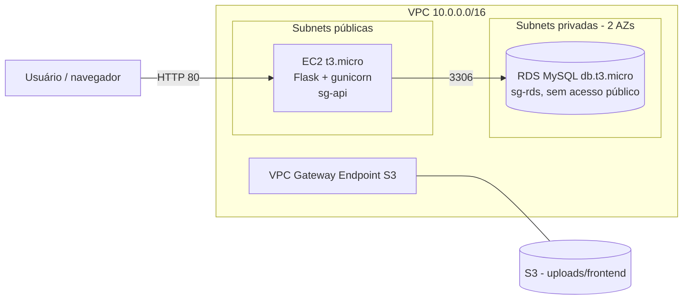
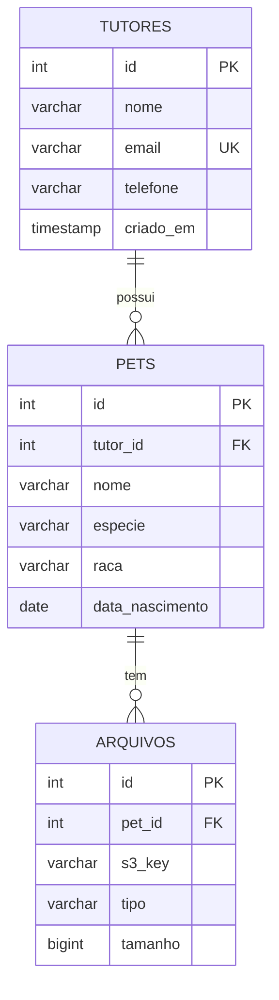

# Design – Clínica Veterinária

## 1. Arquitetura (entrega 23/10: rede + RDS + CRUD)

*(Próximas entregas: S3 → Lambda → RDS, API Gateway + Lambda de relatório, front estático no S3.)*

## 2. Modelo ER

Scripts: `db/schema.sql` e `db/seed.sql`.

## 3. Rotas da API
| Método | Rota | Descrição |
|---|---|---|
| GET | /health | Testa API e conexão com o RDS |
| GET/POST | /api/tutores | Lista / cria tutor |
| GET/PUT/DELETE | /api/tutores/{id} | Consulta / atualiza / exclui |
| GET/POST | /api/pets (?tutor_id=) | Lista (JOIN com tutor) / cria pet |
| GET/PUT/DELETE | /api/pets/{id} | Consulta / atualiza / exclui |
| POST | /api/pets/{id}/upload-url | *(RF-02, a fazer)* URL pré-assinada |
| GET | /relatorios/pets-por-tutor | *(RF-04, a fazer)* API Gateway + Lambda |

## 4. Rede e Security Groups
| SG | Entrada | Origem | Motivo |
|---|---|---|---|
| sg-api (EC2) | TCP 80 | 0.0.0.0/0 | Acesso à aplicação |
| sg-api (EC2) | TCP 22 | 0.0.0.0/0 (ou EC2 Instance Connect) | Administração no Learner Lab |
| sg-rds | TCP 3306 | **somente sg-api** | Só a aplicação acessa o banco |

- VPC 10.0.0.0/16, 2 subnets públicas e 2 privadas (2 AZs; o DB Subnet Group exige 2 AZs).
- RDS: *Publicly accessible = No*, subnets privadas. Sem NAT Gateway (custo).
- VPC Gateway Endpoint para S3 (gratuito) para as Lambdas futuras.

## 5. ADRs
### ADR-01 (RNF-04): CRUD em EC2 (processo Flask) e não em Lambda
- **Contexto:** CRUD precisa falar com RDS em subnet privada; Lambda na VPC não tem internet e adiciona cold start/endpoint extra.
- **Decisão:** CRUD roda na EC2 t3.micro (gunicorn + systemd) na subnet pública, acessando o RDS pela rede privada. Lambdas ficam para eventos (RF-03) e relatório (RF-04).
- **Consequências:** + simples de depurar e demonstrar; + sem cold start; − IP público muda a cada sessão (README cobre); − custo de instância ligada.

### ADR-02: MySQL no RDS
Relacional atende 1:N e JOIN/GROUP BY do relatório; `db.t3.micro` cabe no orçamento.

### ADR-03: Segredos fora do repositório (RNF-02)
Credenciais em `/opt/app/.env` na EC2 (fora do git). Bônus futuro: Secrets Manager/Parameter Store.
